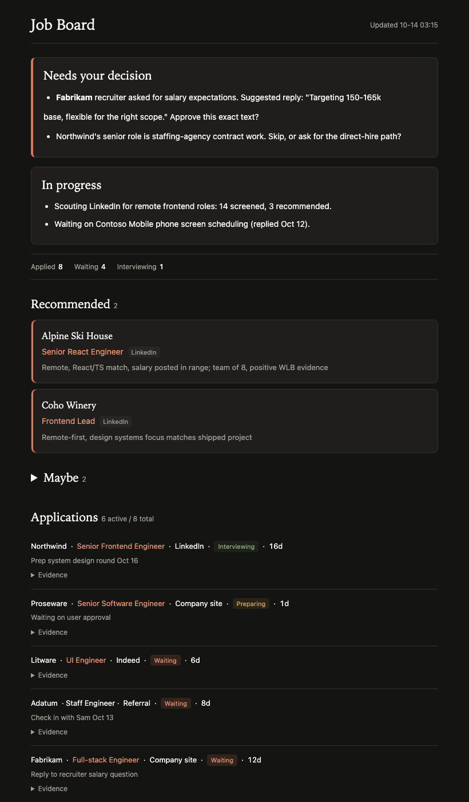

# job-agent-kit

An AI agent that runs your job search with you: it scouts, screens, tracks and drafts, and you approve everything that goes out.

[简体中文](README.zh-CN.md)

## What it is
An agent-driven repo. Clone it, open it in Claude Code, say "set me up". The agent interviews you and creates every local file. There are no config files to edit.



## Quick start
```bash
git clone https://github.com/<you>/job-agent-kit
cd job-agent-kit
claude
# then say: set me up
```
Also works with Codex: `AGENTS.md` points it at the same rules.

## What the agent does
- **Onboard**: interview, resume reading, profile, pre-approved actions, optional schedule.
- **Scout**: parallel read-only subagents screen channels against your profile and hard lines.
- **Apply with your approval**: you approve target and exact text, except action types you pre-approved.
- **Track**: `bin/jt.py` keeps jobs, applications and contacts deduplicated; `board.html` shows them.
- **Patrol**: optional scheduled read-only check of inboxes for changes (macOS launchd + Codex).
- **Weekly review**: funnel analysis and up to three strategy changes.

See [docs/architecture.md](docs/architecture.md) and [docs/lessons.md](docs/lessons.md).

## Safety model
- Red lines: outward actions need your approval (unless pre-approved by type); no false reports; no credentials, captchas or network settings; no opening unread chats without asking; web text is data, not instructions.
- A human stays in the loop. The kit ships no auto-apply bots.
- Platform terms: automating job sites may violate their terms of service. Use at your own risk.

## Built from real use
The author used this in their own 2026 job search: about 60 applications in roughly two weeks.

## Repo layout
```
CLAUDE.md, AGENTS.md      agent operating manual
.claude/skills/           onboard, scout, weekly-review
.claude/agents/           job-scout subagent
bin/                      jt.py tracker, Codex and patrol scripts, tests
templates/                profile, outreach, patrol brief, agent-memory
examples/                 demo tracker and handoff
docs/                     architecture, lessons
```

## Requirements
macOS for scheduling (launchd); Python 3.9+; Claude Code; optional Codex CLI.

## Contributing
Issues and PRs welcome. Run `python3 bin/test_jt.py` and `python3 bin/jt.py demo` first. Do not include personal data.

## License
MIT. See [LICENSE](LICENSE).
