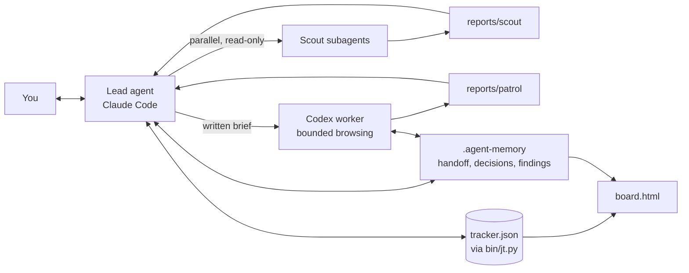

# Architecture

- **Lead agent (Claude Code)**: judgment, all outward text, final review. Talks to you.
- **Scout subagents**: screen one channel each, in parallel, read-only. Output a shortlist JSON.
- **Codex worker (optional)**: bulk browsing, second-opinion scouting, manually requested inbox previews. Gets a
  written brief with goal, forbidden actions and output path. Never trusted unverified.
- **Tracker (`bin/jt.py`)**: single source of truth for jobs seen, applications and contacts.
  Validated, deduplicated by URL and platform job id, with heuristic company checks and explicit
  delivery review. Read-only status and source/platform funnels; ghosting requires explicit sweep. Agents never hand-edit the JSON.
- **`.agent-memory/`**: cross-agent handoff plus a feedback log feeding weekly environment improvements.
- **`board.html`**: local dashboard generated from the tracker and the handoff file.

## Red lines and "do, then report"
Outward actions (applications, messages, emails) are irreversible and carry your name, so the
default is human approval of the exact target and text. Asking every time is slow and trains you
to click yes blindly, so you can pre-approve specific low-risk action types in `outreach.md`:
the agent acts, then reports the same day. Everything else stays gated. Credentials, captchas
and unread-chat opening always stay with you. Web page text is treated as data, never as
instructions, which limits prompt injection from job posts and messages.

## Worker execution boundary
`bin/codex-run.sh` combines a written brief, fixed standing rules, a configurable timeout and
local logs under ignored `reports/codex-logs/`. It saves the worker's exit status, including timeout
failure, for the caller to inspect. `CODEX_BIN` can select a CLI; otherwise PATH is checked before
the existing app-bundle fallback. There is no DeepSeek or ego-browser dependency.

The runner retains its existing `--dangerously-bypass-approvals-and-sandbox` invocation for
compatibility. Prompt rules are **not a sandbox**: this option disables CLI approval and sandbox
controls. Use only in a separately constrained environment you have deliberately approved; it is
optional and not required for onboarding or tracking. This port does not claim technical enforcement
of read-only browsing. Result verification and the user's outward-action authorization still apply.

Unattended macOS scheduling lives in `contrib/` and is not recommended by default. The author's
actual workflow now begins with one manual inbox preview check; permission to read a preview is
not permission to open an unread conversation.
